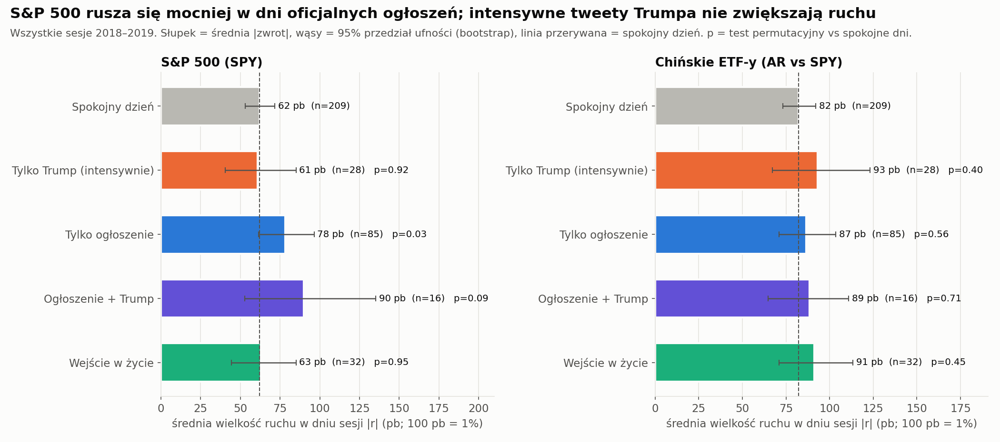
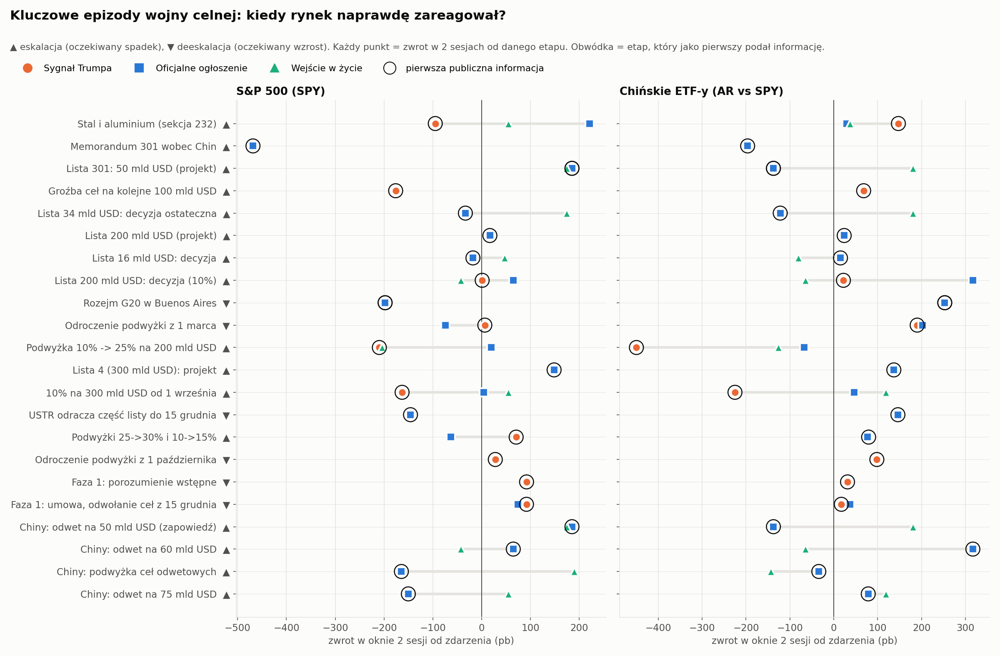
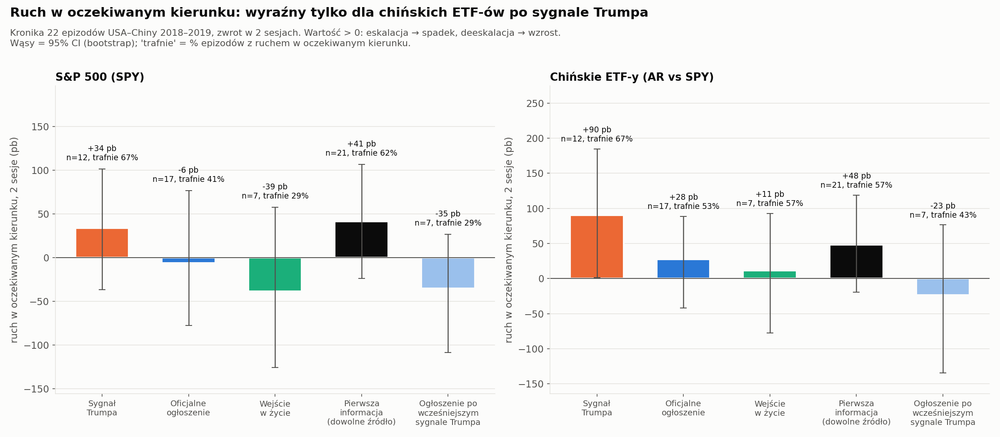
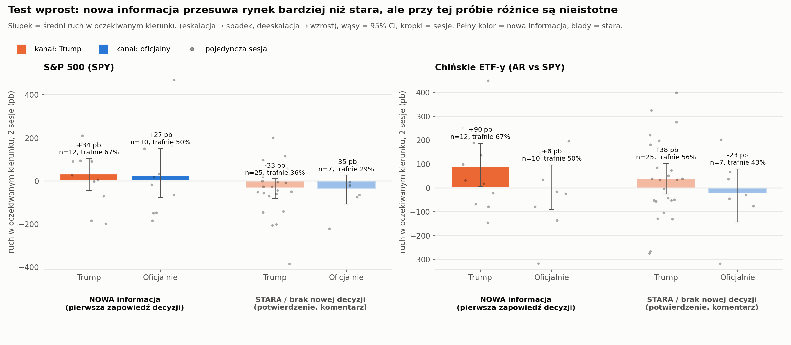
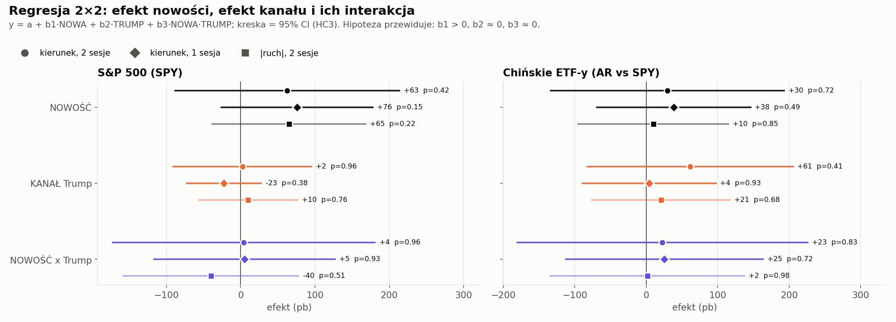

# Rynek reaguje na pierwszą wiarygodną informację o cłach, niezależnie od kanału

> **Hipoteza (przeformułowana):** rynek reaguje na *pierwszą wiarygodną informację* o zmianie ceł, bez względu na to,
> czy podaje ją rząd (USTR, proklamacja, Federal Register), czy Trump na Twitterze. Późniejsze potwierdzenie
> i samo wejście ceł w życie są już wycenione.
>
> **Hipoteza wyjściowa** brzmiała: „rynek reaguje na oficjalne cła, a Trump je tylko nagłaśnia”. Dane potwierdzają ją
> tylko częściowo (patrz *Wniosek*), stąd nowe sformułowanie.

Skrypt: `analysis/hypothesis_official_vs_trump.py`. Pełne wyniki: `hip_summary.txt`, tabele `hip_*.csv`.
Rynki: S&P 500 (SPY) i chińskie ETF-y (koszyk 5 ETF, zwrot nadzwyczajny względem SPY). Dane dzienne, sesje NYSE 2018–2019.

## Dwa podejścia

**A. Wszystkie 503 sesje.** Każdy dzień ma typ:
- **oficjalne ogłoszenie:** GTA (duże interwencje albo USA–Chiny), merytoryczne dokumenty Federal Register, kronika;
- **wejście ceł w życie;**
- **intensywny dzień Trumpa:** ≥ 3 tweety o cłach, górne 10% dni. Tweet o cłach pojawia się w 44% sesji, więc pojedynczy tweet nie jest „zdarzeniem”;
- **spokojny dzień.**

Miara: wielkość ruchu |r|, bo kierunek większości zdarzeń z GTA i FR nie jest oznaczony.

**B. Kronika 22 kluczowych epizodów USA–Chiny.** Dla każdego epizodu trzy daty: sygnał Trumpa, oficjalne ogłoszenie i wejście w życie.
Miara: zwrot w 2 sesjach, ze znakiem względem kierunku epizodu (eskalacja powinna dawać spadek, deeskalacja wzrost).
Daty tweetów sprawdziłem w danych. Część godzin oficjalnych komunikatów jest przybliżona (kolumna `uwagi` w `hip_03_kronika.csv`), dlatego okno ma 2 sesje.

## Wyniki

1. **S&P 500 rusza się mocniej w dni oficjalnych ogłoszeń:** 78 pb vs 62 pb w spokojny dzień (p = 0,03). W regresji efekt wynosi +21 pb (p = 0,09).
   **Intensywne tweety Trumpa nie zwiększają ruchu S&P** (−1 pb, p = 0,88). W tym zakresie dane **wspierają hipotezę**.
2. **Na chińskich ETF-ach żaden typ dnia nie różni się od spokojnego** (wszystkie p > 0,4).
3. **Wejście ceł w życie nie porusza żadnego rynku** (S&P +9 pb, p = 0,39; Chiny +6 pb, p = 0,71). Rynek wycenia cła z wyprzedzeniem, a dzień, w którym cła zaczynają obowiązywać, nie wnosi nowej informacji.

4. **W kluczowych epizodach kierunek ma znaczenie, ale tylko na chińskich ETF-ach:**
   - **Sygnał Trumpa:** +90 pb w oczekiwanym kierunku (p = 0,05, trafnie w 67% epizodów).
   - **Oficjalne ogłoszenie:** +28 pb (p = 0,48).
   - **Wejście w życie:** +11 pb (p = 0,85).
   - **Ogłoszenie, gdy Trump powiedział to już wcześniej:** −23 pb (p = 0,69).
5. **W 2019 r. Trump często był pierwszy, a nie tylko „nagłaśniał”.** Tak było 5.05.2019 (podwyżka do 25%: Chiny −450 pb, S&P −210 pb), 1.08.2019 (10% na 300 mld: −225 / −163 pb) i 24.02.2019 (odroczenie: +190 pb).
   Oficjalny dokument przychodził 4–19 dni później i rynek już go nie zauważał.
   W 2018 r. pierwsze były zwykle działania USTR (np. memorandum 22.03.2018: S&P −469 pb, Chiny −196 pb), ale ich kierunek był mniej spójny.
6. **Na S&P 500 w kronice żadna grupa nie jest istotna** (wszystkie p > 0,3). Ruch indeksu w tych dniach zależy też od innych czynników (Fed, wyniki spółek).

## Wniosek

Hipoteza **„rynek reaguje na oficjalne cła, Trump tylko nagłaśnia” jest prawdziwa tylko częściowo:**
- **Prawdziwa** dla rutynowego strumienia tweetów: zwykłe, nawet częste tweety o cłach nie poruszają rynku, a oficjalne ogłoszenia lekko zwiększają ruch S&P 500.
- **Wejście ceł w życie nie ma znaczenia.** Liczy się zapowiedź, a nie wdrożenie.
- **Nieprawdziwa** dla tweetów, które *same były zapowiedzią decyzji* (2019). Wtedy to tweet był nową informacją, chińskie ETF-y reagowały na niego, a późniejszy dokument był już wyceniony.

Przyjmujemy więc hipotezę przeformułowaną: **rynek reaguje na pierwszą wiarygodną informację o zmianie ceł, niezależnie od kanału.**
W 2018 r. był nią zwykle komunikat USTR, w 2019 r. często tweet Trumpa. Dane są z nią spójne:
- ruch rynku pojawia się przy pierwszej informacji, a nie przy potwierdzeniu;
- tweety, które nie niosą nowej decyzji (zdecydowana większość), rynku nie ruszają;
- wejście ceł w życie jest neutralne, bo zostało wycenione wcześniej.

Test tej hipotezy wprost jest w sekcji niżej.

## Test wprost (układ 2×2: nowość informacji × kanał)

Skrypt: `analysis/hypothesis_first_info_test.py`. Wyniki: `test_summary.txt`, `test_*.csv`.

Komunikaty z obu kanałów podzieliłem na 4 klasy, ustalone przed patrzeniem na zwroty:

| | Trump | Oficjalnie |
|---|---|---|
| **Nowa informacja** (pierwsza zapowiedź decyzji z kroniki) | 12 sesji | 10 sesji |
| **Stara / brak nowej decyzji** | 25 sesji: tweety o cłach z próby gold, poza dniami kroniki (±1 sesja) | 7 sesji: oficjalne ogłoszenie decyzji, którą Trump podał wcześniej |

Hipoteza przewiduje: efekt **nowości > 0**, efekt **kanału ≈ 0**, interakcja ≈ 0.

**Ruch w oczekiwanym kierunku, 2 sesje (pb):**

| | S&P 500 | Chińskie ETF-y |
|---|---|---|
| Nowa / Trump | +34 | +90 |
| Nowa / oficjalnie | +27 | +6 |
| Stara / Trump | −33 | +38 |
| Stara / oficjalnie | −35 | −23 |
| **Efekt nowości** (nowa − stara) | **+64 (p = 0,09)** | +28 (p = 0,55) |
| **Efekt kanału** przy nowej informacji (Trump − oficjalnie) | +7 (p = 0,93) | +84 (p = 0,25) |

**Wyniki:**
1. **Znaki są zgodne z hipotezą na S&P 500.** Nowa informacja daje ruch w oczekiwanym kierunku w obu kanałach (+34 i +27 pb), stara w obu nie (−33 i −35 pb).
   Kanał praktycznie nie ma znaczenia (różnica +7 pb przy nowej i +2 pb przy starej informacji).
2. **Efekt nowości na S&P jest na granicy istotności:** +64 pb, p = 0,09 przy etykietach MG.
   Przy etykietach zgodnych (MG i PK zgodni) wynosi **+97 pb, p = 0,04**, a w samym kanale Trumpa **+120 pb, p = 0,05**.
3. **Chińskie ETF-y nie pasują do „niezależnie od kanału”.** Nowa informacja od Trumpa: +90 pb, nowa informacja oficjalna: tylko +6 pb.
   Różnica jest nieistotna (p = 0,25), ale idzie w przeciwną stronę niż przewiduje hipoteza.
   Możliwe wyjaśnienie: komunikaty USTR z 2018 r. częściowo poprzedzały przecieki prasowe, więc „pierwsza oficjalna” informacja nie zawsze była dla rynku pierwszą.
4. **Wielkość ruchu |r| nie różnicuje klas** (nowa vs stara: +41 pb na S&P, p = 0,11; +6 pb na Chinach, p = 0,84).
   Dni ze starą informacją ruszają się tak samo jak zwykłe dni.
5. **Po korekcie FDR nic nie jest istotne.** Przy 7–25 obserwacjach na klasę test wykrywa dopiero różnice rzędu 150–200 pb.

**Werdykt:** test wprost **nie obala** przeformułowanej hipotezy, ale też jej **nie potwierdza** na poziomie istotności.
Na S&P 500 wzór jest dokładnie taki, jak przewiduje hipoteza (liczy się nowość, nie kanał), z efektem na granicy istotności.
Na chińskich ETF-ach nowość od Trumpa działa mocniej niż nowość oficjalna, co podważa część „niezależnie od kanału”.
Żeby rozstrzygnąć, potrzeba więcej epizodów (np. dodanie lat 2025–2026 z Truth Social) albo danych śróddziennych, które oddzielą tweet od komunikatu w tej samej sesji.

## Ograniczenia

- Mała próba w kronice (7–17 epizodów na grupę), szerokie przedziały ufności. Wynik +90 pb jest na granicy istotności (p = 0,05, CI od +1 do +185 pb).
- Dane dzienne: nie da się rozdzielić reakcji na tweet i ogłoszenie, gdy oba wypadają w tej samej sesji (2 epizody).
- Kronikę ułożyłem ręcznie. Daty tweetów są sprawdzone w danych, ale godziny części oficjalnych komunikatów są przybliżone, a daty z Federal Register to daty publikacji (mogą być późniejsze niż komunikat USTR).
- Lista oficjalnych zdarzeń z GTA i FR jest szeroka i zawiera też zdarzenia mało istotne, co może zaniżać efekt w analizie A.
